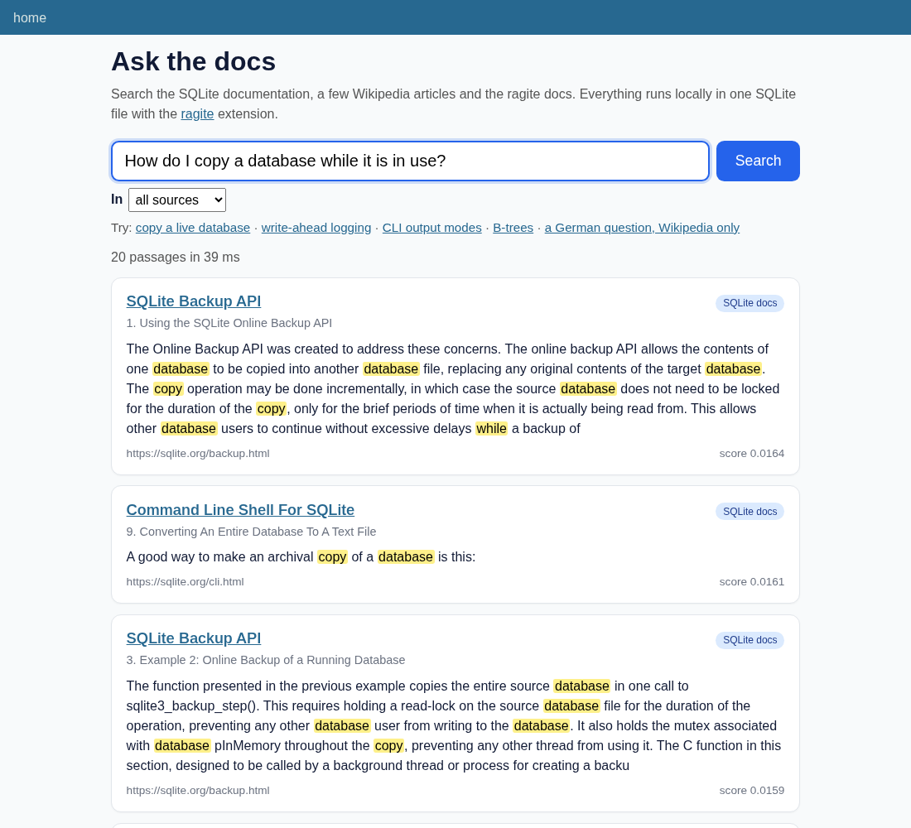

<h1>
  <picture>
    <source media="(prefers-color-scheme: dark)" srcset="docs/assets/ragite-demo-readme-lockup-dark.svg">
    
  </picture>
</h1>

Search the SQLite docs and Wikipedia in your browser with [ragite](https://github.com/pihme/ragite) and [Datasette](https://datasette.io/), offline and in one SQLite file.

[](https://github.com/pihme/ragite-demo/actions/workflows/ci.yml)
[](LICENSE)
[](data/sources.json)

**[Website](https://pihme.github.io/ragite-demo/)** · [ragite](https://github.com/pihme/ragite) · [Data sources](DATA_SOURCES.md)



ragite is a SQLite extension for retrieval: it splits documents into chunks, embeds them on the CPU and finds the best passages with a hybrid search (vector similarity plus BM25 full text). This demo indexes about 1.9 MB of freely licensed text and serves it with Datasette, so you get a search page without writing a web app, and the full SQL interface next to it.

## Requirements

- **Linux x86-64.** ragite publishes release binaries for Linux only so far ([pihme/ragite#35](https://github.com/pihme/ragite/issues/35)). On macOS or Windows, use a Linux container or build ragite yourself.
- Python 3.10+ whose `sqlite3` module can load extensions (true for most Linux builds; check with `python3 -c "import sqlite3; sqlite3.connect(':memory:').enable_load_extension(True)"`).
- About 165 MB of disk: `libragite.so` is ~135 MB because the embedding model is built in; `demo.db` is ~25 MB.

## Quickstart

```bash
git clone https://github.com/pihme/ragite-demo.git
cd ragite-demo
python3 -m venv .venv && . .venv/bin/activate
pip install -r requirements.txt

# Downloads libragite.so (ragite v0.3.0) and the pinned sources, checks them, builds app/demo.db.
scripts/build-demo-db

# The demo with the search page: http://127.0.0.1:8001/search
datasette serve app --load-extension ./libragite --port 8001
```

`app/` is a Datasette [configuration directory](https://docs.datasette.io/en/stable/settings.html#configuration-directory-mode): it holds `demo.db`, the canned queries in `metadata.yml`, the search page in `templates/pages/search.html` and its local CSS and JavaScript in `static/`. No CDN or external service is used at run time.

Only the database, with Datasette's plain table and SQL views:

```bash
datasette app/demo.db --load-extension ./libragite
```

Pass the library path **without** `.so`: SQLite adds the suffix itself (see the ragite README). Already have a `libragite.so`? `scripts/build-demo-db --lib /path/to/libragite.so` uses it instead of downloading.

## What you can do

**Search page** (`/search`): type a question and optionally limit it to one source with the chips. Results are cards with the source, the document title, the heading path inside the document and the matching chunk with your words highlighted. When the hit is very short, usually a bare heading, the card shows the heading in the path and the text that follows it in the same section as the body. Each card has a relevance bar relative to the best card of the search (Best match, Very close, Close, Related; the RRF score is in its tooltip), a "meaning + keywords" badge when both rankings found the passage, and links to the source, the document row in `doc_info` and the chunk row in `docs_chunks`. Five cards show at first, "Show 5 more" reveals the rest of the up to 20. Each passage appears once: a hit that a better card already shows (mostly, at least half of it), or with the same text as a better card, is left out; neighbouring pieces of a long paragraph both stay. Every search links to the same query as SQL.

**Canned queries** (`/demo`, hybrid search only), usable from the browser or as JSON (`/demo/search.json?q=...&collection=&_shape=array`):

| Query | Ranking | Score |
| --- | --- | --- |
| `search` | Hybrid: `docs_chunks MATCH :q`, vector and BM25 fused by Reciprocal Rank Fusion; context for short hits, each passage once (rule below) | RRF score, higher is better (at most 2/61) |
| `search_documents` | Hybrid, one row per document (`docs MATCH :q`) | RRF score of the best chunk |
| `chunks_with_document` | Hybrid chunks joined to `docs` and `doc_info`, with positions | RRF score |
| `document_chunks` | All chunks of one `doc_id`, in order (no search) | none |
| `model` | `ragite_default_model()` and `ragite_table_model('docs')` | none |
| `embed` | `ragite_embed('docs', :text, :role)`: dimensions and first bytes | none |

**Rule for `search`** ([SPEC](SPEC.md) D9): A short hit (under 80 characters, usually a bare heading) gets the next chunks of the same document and section as context: chunks that start after it, whose heading path begins with the hit's heading path, and that have at least 40 characters; at most two, and only until the card holds 200 characters. Cards are then taken in score order from the best 60 hits, at most 20. Each displayed piece (the hit, and each context chunk) is a span of the document; a span counts as already shown when at least half of its length lies inside spans displayed by better cards of the same document. A hit is dropped when its own span is already shown (for example the paragraph under a heading card), when it is a short hit whose context is all shown already (a heading whose paragraph is on screen), or when its text, context included, equals a better card's text after trimming and lower-casing (the same sentence on two pages). Context that is already shown is left out of a kept card. Neighbouring pieces of a split paragraph share only ragite's short overlap, so both stay. The `spans` column lists the displayed spans.

All of them use only ragite's public interface: the Document table, its `_chunks` companion and the `ragite_*` functions. `collection` is empty for all sources, or one of `sqlite-docs`, `wikipedia`, `ragite-docs`.

**Known limit of the source filter** ([pihme/ragite#49](https://github.com/pihme/ragite/issues/49)): ragite takes a fixed number of best candidates from all sources, fuses them, and only then does the query keep the rows of the chosen source. A source that ranks lower overall can come back with few or no passages even though it has matching text; for example `FTS5` limited to `ragite-docs` returns nothing, although 11 ragite-docs chunks contain that word. The search page says so whenever a source filter is active. Searching all sources, or rephrasing, helps until ragite lets filters reach past the candidate depth.

**More SQL**: [examples/](examples/) has runnable `.sql` files for every part of ragite's public interface: create a table, insert each format, update and delete, search documents and chunks, join a chunk to its document, show the model, embed text.

**Raw SQL** (`/demo?sql=...`), for example:

```sql
SELECT i.title, c.chunk, c.score
FROM docs_chunks c JOIN doc_info i ON i.doc_id = c.doc_id
WHERE docs_chunks MATCH 'How do I change the output mode of the sqlite3 shell?'
LIMIT 5;
```

SQLite normally runs the search first and then looks up `doc_info` by `doc_id`. The canned queries make that order explicit with a `MATERIALIZED` CTE, so a different query plan can never run the search once per row of the joined table.

## Data

| Collection | Documents | Cleaned text | License |
| --- | --- | --- | --- |
| SQLite documentation 3.54.1 (subset, incl. the `sqlite3` CLI page) | 74 | 1.52 MB | Public domain |
| Wikipedia: SQLite (en, de), SQL, Relational database, B-tree; Retrieval-augmented generation (en, de), Large language model, Information retrieval, Semantic search, Full-text search, Inverted index, Okapi BM25, Tf–idf, Word embedding, Sentence embedding, Cosine similarity, Vector database, Nearest neighbor search, Hierarchical navigable small world | 20 | 0.30 MB | CC BY-SA 4.0 |
| RAGite README, SPEC, GLOSSARY, user guide, tinkering guide | 5 | 0.09 MB | MIT OR Apache-2.0 |

That is 8,751 chunks and a 25 MB `demo.db` (2 KB of vector per chunk). ragite makes every heading, list item and table cell its own chunk, so the build joins each table row into one paragraph (cells separated by ` | `) and each list of short items into one paragraph (items separated by `; `), and turns no-break spaces into plain spaces. Headings still become short chunks of their own and can rank high for one-word queries. Exact sources, pinned revisions, the cleaning steps and attribution: [DATA_SOURCES.md](DATA_SOURCES.md).

`demo.db` is not committed: it is a 25 MB binary that the build script recreates from pinned inputs in a few seconds, and keeping the Wikipedia text out of the repository keeps the code under one license. CI uploads each build as an artifact (`demo-db`, with `DATA_SOURCES.md`).

## Limits

- The built-in model (potion-retrieval-32M) is trained for English. In this small set, German questions still find the German Wikipedia article, but expect weaker ranking for non-English text in general.
- ragite's full-text side matches the query as one phrase, so long questions usually rank by vector similarity alone; short keyword queries get both.
- The SQLite docs link to sqlite.org, which may already describe a newer version than 3.54.1.

## Tests

```bash
pip install -r requirements-dev.txt
make demo-db test            # build, then Datasette test-client checks and the SQL examples
scripts/run-examples         # the SQL examples through the sqlite3 shell
make serve & make smoke      # the same searches over HTTP
```

CI builds `demo.db`, runs the tests and every SQL example, queries a running `datasette serve` with `curl`, and uploads screenshots of the search page (artifact `screenshots`).

## Contributing

See [CONTRIBUTING.md](CONTRIBUTING.md). Security issues: [SECURITY.md](SECURITY.md).

## How this project is built

ragite-demo is developed agent-first. AI coding agents write all code,
tests, and documentation, and review each other's changes, under human
direction: specs, design decisions, and acceptance based on observed
behaviour and test results. No human reads the code line by line. This
is a deliberate choice. Quality rests on automated tests, CI, and
independent agent review.

Evaluate the code against your own requirements before you depend on it.
Found a problem? Open an issue.

## License

Code: [MIT](LICENSE). The indexed data keeps its own licenses ([DATA_SOURCES.md](DATA_SOURCES.md)). Third-party software and data: [THIRD_PARTY_NOTICES.md](THIRD_PARTY_NOTICES.md).
